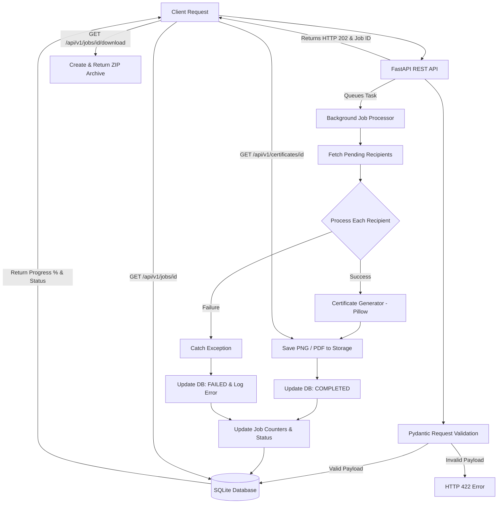

# Bulk Certificate Generator API

Bulk Certificate Generator is a FastAPI-based backend service designed for the **Aereo Software Development Engineer Intern** assignment. It accepts a single bulk certificate generation request, validates recipients, processes certificates asynchronously in the background, tracks real-time job progress and individual recipient status, isolates individual failures, and provides generated certificates for individual or bulk ZIP retrieval.

---

## Features

- **Bulk Certificate Generation**: Submit generation requests for dozens or hundreds of recipients in a single API request.
- **REST API**: Clean, intuitive endpoints following OpenAPI standards.
- **Input Validation**: Robust request payload validation using Pydantic V2 (validating names, email syntax, required fields, and batch size).
- **Background Processing**: Asynchronous non-blocking execution using FastAPI `BackgroundTasks`, returning an immediate HTTP 202 response.
- **Job Status & Progress Tracking**: Live status updates with detailed counters (`total_count`, `processed_count`, `success_count`, `failed_count`) and percentage progress.
- **Individual Certificate Status**: Per-recipient status tracking (`PENDING`, `GENERATING`, `COMPLETED`, `FAILED`) and stored error messages.
- **Failure Isolation**: Errors during generation for a single recipient do not break or abort the rest of the batch.
- **PDF & PNG Support**: Flexible certificate rendering into high-resolution PNG images or PDF documents using Pillow.
- **Certificate Retrieval**: Fetch individual certificate files and JSON metadata via dedicated endpoints.
- **ZIP Download**: Download all successfully generated certificates in a batch as a compressed `.zip` archive.
- **Automated Tests**: Comprehensive test suite using Pytest and HTTPX covering validation, status progress, rendering, and failure resilience.

---

## Tech Stack

- **Language**: Python 3.10+
- **Backend Framework**: FastAPI (Starlette)
- **Data Validation**: Pydantic V2 & `email-validator`
- **Database & ORM**: SQLAlchemy 2.0 with SQLite relational database
- **Certificate Generator Engine**: Pillow (PIL)
- **Testing**: Pytest & HTTPX (`TestClient`)

---

## Aereo Assignment Requirement Mapping

| Assignment Requirement | Technical Implementation | Status |
| :--- | :--- | :--- |
| **Bulk Request** | `POST /api/v1/jobs` accepts batch recipient payload | Implemented |
| **Input Validation** | Pydantic V2 schemas (`JobCreate`, `RecipientCreate`) | Implemented |
| **Relational Database** | SQLAlchemy 2.0 ORM with SQLite relational schema | Implemented |
| **Job Tracking** | `Job` relational database model tracking job lifecycle | Implemented |
| **Individual Tracking** | `Certificate` relational model linked to `Job` via FK | Implemented |
| **Certificate Generation** | Modular rendering service in `app/services/generator.py` using Pillow | Implemented |
| **Background Processing** | Non-blocking execution via FastAPI `BackgroundTasks` | Implemented |
| **Progress Tracking** | Live counters (`processed`, `success`, `failed`) and calculated `progress` % | Implemented |
| **Failure Isolation** | Isolated `try...except` block per recipient in background worker | Implemented |
| **Certificate Retrieval** | `GET /api/v1/certificates/{certificate_id}` endpoint | Implemented |
| **Bulk Download** | `GET /api/v1/jobs/{job_id}/download` ZIP archive endpoint | Implemented |
| **Automated Tests** | Automated test suite in `tests/` using Pytest and HTTPX | Implemented |

---

## Architecture & Workflow Diagram



---

## API Documentation

### 1. Submit Bulk Certificate Generation Job
- **Method**: `POST`
- **URL**: `/api/v1/jobs`
- **Purpose**: Accepts a bulk certificate request, validates recipient data, creates database records, and triggers asynchronous background processing.
- **Status Codes**: `202 Accepted` (Success), `422 Unprocessable Entity` (Validation Error).

#### Request Body Example:
```json
{
  "event_name": "Python Development Workshop",
  "organization": "Aereo Software Engineering",
  "certificate_title": "Certificate of Participation",
  "date": "2026-10-07",
  "file_format": "png",
  "recipients": [
    {
      "name": "Surendra",
      "email": "surendra@example.com"
    },
    {
      "name": "Rahul",
      "email": "rahul@example.com",
      "course_name": "Advanced FastAPI Engineering"
    }
  ]
}
```

#### Response Example (`202 Accepted`):
```json
{
  "id": "e9a1b2c3-4d5e-6f7a-8b9c-0d1e2f3a4b5c",
  "title": "Certificate of Participation",
  "event_name": "Python Development Workshop",
  "file_format": "png",
  "status": "PENDING",
  "total_count": 2,
  "processed_count": 0,
  "success_count": 0,
  "failed_count": 0,
  "progress": 0.0,
  "created_at": "2026-10-07T18:30:00Z",
  "updated_at": "2026-10-07T18:30:00Z"
}
```

---

### 2. Check Job Status & Progress
- **Method**: `GET`
- **URL**: `/api/v1/jobs/{job_id}`
- **Purpose**: Retrieves real-time job progress, total/processed/success/failed counts, progress percentage, and individual recipient statuses.
- **Status Codes**: `200 OK`, `404 Not Found`.

#### Response Example (`200 OK`):
```json
{
  "id": "e9a1b2c3-4d5e-6f7a-8b9c-0d1e2f3a4b5c",
  "title": "Certificate of Participation",
  "event_name": "Python Development Workshop",
  "file_format": "png",
  "status": "COMPLETED",
  "total_count": 2,
  "processed_count": 2,
  "success_count": 2,
  "failed_count": 0,
  "progress": 100.0,
  "created_at": "2026-10-07T18:30:00Z",
  "updated_at": "2026-10-07T18:30:02Z",
  "certificates": [
    {
      "id": "c1111111-2222-3333-4444-555555555555",
      "job_id": "e9a1b2c3-4d5e-6f7a-8b9c-0d1e2f3a4b5c",
      "recipient_name": "Surendra",
      "recipient_email": "surendra@example.com",
      "course_name": "Certificate of Participation",
      "issue_date": "2026-10-07",
      "status": "COMPLETED",
      "file_format": "png",
      "download_url": "/api/v1/certificates/c1111111-2222-3333-4444-555555555555",
      "error_message": null,
      "created_at": "2026-10-07T18:30:00Z",
      "updated_at": "2026-10-07T18:30:01Z"
    },
    {
      "id": "c2222222-3333-4444-5555-666666666666",
      "job_id": "e9a1b2c3-4d5e-6f7a-8b9c-0d1e2f3a4b5c",
      "recipient_name": "Rahul",
      "recipient_email": "rahul@example.com",
      "course_name": "Advanced FastAPI Engineering",
      "issue_date": "2026-10-07",
      "status": "COMPLETED",
      "file_format": "png",
      "download_url": "/api/v1/certificates/c2222222-3333-4444-5555-666666666666",
      "error_message": null,
      "created_at": "2026-10-07T18:30:00Z",
      "updated_at": "2026-10-07T18:30:02Z"
    }
  ]
}
```

---

### 3. List All Jobs
- **Method**: `GET`
- **URL**: `/api/v1/jobs?skip=0&limit=20`
- **Purpose**: Lists all submitted generation jobs with pagination.
- **Status Codes**: `200 OK`.

---

### 4. Retrieve Individual Certificate File
- **Method**: `GET`
- **URL**: `/api/v1/certificates/{certificate_id}`
- **Purpose**: Downloads or views the generated certificate file (`image/png` or `application/pdf`).
- **Status Codes**: `200 OK`, `400 Bad Request` (Not completed yet), `404 Not Found`.

---

### 5. Retrieve Certificate Metadata
- **Method**: `GET`
- **URL**: `/api/v1/certificates/{certificate_id}/metadata`
- **Purpose**: Fetches JSON metadata and current generation status of a specific certificate.
- **Status Codes**: `200 OK`, `404 Not Found`.

---

### 6. Download Bulk ZIP Archive
- **Method**: `GET`
- **URL**: `/api/v1/jobs/{job_id}/download`
- **Purpose**: Returns a `.zip` archive containing all successfully generated certificates in the batch.
- **Status Codes**: `200 OK`, `400 Bad Request` (No completed certificates), `404 Not Found`.

---

## Job Lifecycle & Progress Metrics

Every generation job moves through a defined set of lifecycle states:

```text
       PENDING
          ↓
      PROCESSING
      /   |    \
     /    |     \
    v     v      v
COMPLETED  PARTIALLY_COMPLETED  FAILED
```

### Lifecycle States:
- **`PENDING`**: Job created and queued for background execution.
- **`PROCESSING`**: Worker actively generating certificates for recipients.
- **`COMPLETED`**: All certificates in the job generated successfully (`failed_count == 0`).
- **`PARTIALLY_COMPLETED`**: At least one certificate succeeded and at least one failed (`success_count > 0` and `failed_count > 0`).
- **`FAILED`**: All certificates in the batch failed to generate (`success_count == 0` and `failed_count == total_count`).

### Progress Calculation:
$$ \text{processed\_count} = \text{success\_count} + \text{failed\_count} $$
$$ \text{progress (\%)} = \left( \frac{\text{processed\_count}}{\text{total\_count}} \right) \times 100 $$

---

## Failure Isolation Architecture

A core requirement of the system is resilience against individual rendering failures. If certificate generation fails for one recipient (e.g. invalid name characters, image processing exception, or corrupt parameter), the error is logged against that specific certificate, and background processing immediately continues for the remaining recipients.

### Concrete Example:
- **Batch Size**: 10 recipients
- **Successful**: 9 recipients
- **Failed**: 1 recipient (e.g. rendering exception)

#### Final Job Result:
```json
{
  "total_count": 10,
  "processed_count": 10,
  "success_count": 9,
  "failed_count": 1,
  "progress": 100.0,
  "status": "PARTIALLY_COMPLETED"
}
```
The 9 successful certificates are fully retrievable and included in the batch ZIP download, while the failed certificate records the detailed error message for troubleshooting.

---

## Design Decision: Why BackgroundTasks vs. Celery?

For this assignment, **FastAPI `BackgroundTasks`** was selected to keep the implementation lightweight, self-contained, and zero-dependency for local execution. The API immediately returns a job identifier to the client while certificate rendering happens asynchronously in the background.

### Production Comparison:

| Consideration | FastAPI BackgroundTasks (Current) | Celery + Redis (Production Recommendation) |
| :--- | :--- | :--- |
| **Infrastructure** | Zero external dependencies (runs in app process) | Requires Redis/RabbitMQ broker & Celery workers |
| **Suitability** | Ideal for single-instance, assignment/dev workloads | Ideal for heavy, multi-server distributed workloads |
| **Persistence** | Tasks run in memory (restarts abort pending tasks) | Persistent task queue with retry policies & dead letter queues |
| **Scaling** | Vertical scaling on single server instance | Horizontal scaling across multiple worker nodes |

---

## Key Design Decisions

1. **Why FastAPI?**  
   Provides high-performance asynchronous request handling, automatic OpenAPI/Swagger documentation generation, and native integration with Pydantic V2 data validation.

2. **Why a Relational Database (SQLite + SQLAlchemy 2.0)?**  
   Encforces structured relational integrity between batch jobs (`Job`) and individual items (`Certificate`), enabling transactional updates of progress metrics and SQL querying. SQLite provides zero-setup local storage.

3. **Why Separate `Job` and `Certificate` Models?**  
   Decouples overall job batch state (progress %, overall status, total counts) from per-recipient data (recipient details, individual status, file path, error logs).

4. **Why Per-Recipient Failure Isolation?**  
   Prevents one bad input from invalidating an entire event's certificates. Organizers can retrieve valid certificates immediately and re-run failed items separately.

5. **Why UUID Identifiers?**  
   Prevents enumeration attacks on certificate download URLs and provides globally unique identifiers across systems.

6. **Why Service Layer Separation (`generator.py` & `job_processor.py`)?**  
   Keeps API handlers slim by delegating rendering logic and background iteration to dedicated, testable service components.

7. **Why Validation Before Processing?**  
   Rejects malformed JSON requests, empty recipient lists, or invalid email formats synchronously at the API layer before creating database entities or queuing background work.

---

## How to Setup and Run

### 1. Prerequisites
- Python 3.10 or higher.

### 2. Installation
Clone the repository and install dependencies:

```bash
git clone https://github.com/surendrat969-cloud/bulk-cirtificate.git
cd bulk-cirtificate
pip install -r requirements.txt
```

### 3. Running the Server
Start the Uvicorn server:

```bash
uvicorn app.main:app --reload --port 8000
```

- **Live API Docs**: [http://127.0.0.1:8000/docs](http://127.0.0.1:8000/docs)
- **ReDoc**: [http://127.0.0.1:8000/redoc](http://127.0.0.1:8000/redoc)

### 4. Running Automated Tests
Run the pytest test suite:

```bash
pytest tests/ -v
```

---

## Example Workflow Walkthrough

1. **Start the Server**:  
   Run `uvicorn app.main:app --reload`.
2. **Open Interactive Docs**:  
   Navigate to `http://127.0.0.1:8000/docs`.
3. **Submit a Bulk Job**:  
   Send a `POST /api/v1/jobs` request with a list of recipients. Copy the returned `id` (Job ID).
4. **Track Progress**:  
   Call `GET /api/v1/jobs/{job_id}` to monitor real-time progress until `status` becomes `COMPLETED` or `PARTIALLY_COMPLETED`.
5. **Retrieve Certificates**:  
   Use `GET /api/v1/certificates/{certificate_id}` to view individual files, or call `GET /api/v1/jobs/{job_id}/download` to get the complete ZIP archive.

---

## Future Production Improvements

In a high-scale production deployment, the following enhancements could be introduced:
- **Database**: Upgrade from SQLite to **PostgreSQL** for multi-writer concurrency.
- **Distributed Queue**: Replace `BackgroundTasks` with **Celery + Redis** for distributed task workers.
- **Object Storage**: Store generated certificates on **AWS S3** or Google Cloud Storage instead of local disk.
- **Email Delivery**: Integrate SMTP / SendGrid to automatically email certificates directly to recipients.
- **Authentication**: Add API Key / OAuth2 JWT authentication for tenant access control.
- **Rate Limiting**: Add Redis-backed rate limiting to protect endpoints against abuse.
